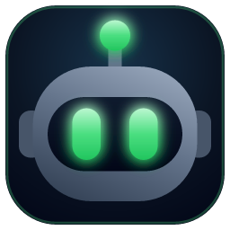
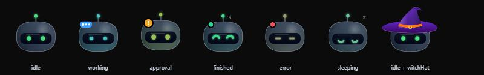
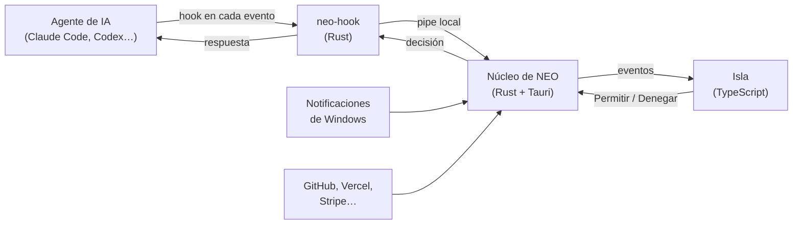

<div align="center">



# NEO

**Un pequeño robot que vive arriba de tu pantalla y vigila a tus agentes de IA.**

Aprueba permisos, responde preguntas y mira qué están haciendo Claude Code, Codex y compañía sin salir de lo que estás haciendo.

[](https://github.com/juann11/NEO/releases)
[](https://github.com/juann11/NEO/actions/workflows/windows-ci.yml)
[](LICENSE)




[Instalar](#instalación) · [Qué hace](#qué-hace) · [Cómo funciona](#cómo-funciona) · [Guía de uso](docs/guia-de-uso.md) · [Arquitectura](docs/arquitectura.md)

</div>

---

## Qué es

Cuando trabajas con agentes de IA, pasas el día saltando a la terminal para ver si terminaron o si esperan un permiso. **NEO lleva todo eso a una isla** discreta arriba al centro de la pantalla.

La isla se queda escondida mientras no pasa nada. Cuando un agente trabaja, termina o te necesita, NEO se asoma y sus ojos cambian de color para decirte qué ocurre: 🟢 en reposo, 🔵 trabajando, 🟠 esperando tu permiso, 🔴 con un error.

Es una app de escritorio nativa, ligera y local: **sin cuenta, sin telemetría y sin servidores propios**.

## Qué hace

### Para tus agentes
- **Sesiones en vivo:** qué lee, edita y ejecuta cada agente, paso a paso.
- **Permisos desde la isla:** Permitir o Denegar con un clic. Nunca se aprueba nada sin tu clic.
- **Preguntas:** responde a las preguntas de Claude Code sin ir a la terminal.
- **Diffs:** cada archivo cambiado con sus líneas añadidas y quitadas.
- **Uso del plan:** tus límites de Claude y Codex a la vista.
- **Resumen semanal:** horas, sesiones, archivos y proyectos de la semana.

Compatible con **Claude Code, Claude Desktop, Codex, Cursor, Gemini CLI, Copilot CLI, OpenCode, Amp, Antigravity, Muse Code y Hermes**, y con cualquier otra herramienta que pueda lanzar un comando en sus hooks.

### Para tu día a día
- **Notificaciones de Windows en la isla:** las de WhatsApp, Teams o cualquier app salen solo en NEO, con historial de las últimas 10 y botón para abrir la app.
- **Chat:** Claude, Google AI, OpenAI, OpenRouter o un modelo local (Ollama, LM Studio), con tus propias claves.
- **Suelta un archivo** en la isla y pregunta sobre él.
- **Dictado:** mantén una tecla, habla y el texto se escribe donde estés. Funciona sin internet.
- **Notetaker:** graba tus llamadas sin meter un bot y obtén transcripción, resumen y tareas.
- **« OK NEO »:** asistente de voz para preguntar por tus servicios, poner música o abrir apps.

### Tus servicios en pestañas
GitHub, GitLab, Gitea, Vercel, Stripe, Resend, Notion, Cal.com, n8n, Spotify y WhatsApp (experimental). Tú eliges cuáles anclar.

## Instalación

1. Descarga el instalador más reciente: **[NEO-Windows-setup.exe](https://github.com/juann11/NEO/releases/download/windows-latest/NEO-Windows-setup.exe)**.
2. Ábrelo. El instalador aún no está firmado, así que Windows mostrará un aviso: pulsa **Más información → Ejecutar de todos modos**.
3. NEO aparece arriba al centro de la pantalla. Lleva el ratón ahí para que se asome.
4. Pulsa el engranaje ⚙️ de la isla y, en **Agentes**, conecta tus herramientas. NEO te enseña exactamente qué va a cambiar antes de escribir nada.

NEO se actualiza solo: las versiones nuevas llegan a la isla y se instalan con un clic.

¿Usas Linux? Mira [docs/linux.md](docs/linux.md).

## Cómo funciona

Cada agente ejecuta un programa muy pequeño, `neo-hook`, en cada evento (empieza una herramienta, pide un permiso, termina…). `neo-hook` se lo cuenta a la app por un canal local y, si hace falta, espera tu decisión.



Si NEO está cerrado o no responde, `neo-hook` sale al momento y el agente pregunta en su terminal como siempre: **NEO nunca bloquea a tu agente**. Más detalle en [la arquitectura](docs/arquitectura.md).

## Privacidad

- **Sin telemetría, sin cuenta y sin servidores de NEO.**
- Tus claves se guardan en el Administrador de credenciales de Windows (o en Secret Service en Linux), nunca en archivos ni en este repositorio.
- NEO solo habla con los servicios que tú configuras. Antes de buscar actualizaciones te pide permiso.
- Las notificaciones de Windows se leen solo en tu equipo y no se envían a ningún sitio.
- El dictado funciona sin conexión; las grabaciones del Notetaker se borran tras transcribirlas.

## Hecho con

| Parte | Tecnología |
|---|---|
| App de escritorio | [Tauri 2](https://tauri.app) |
| Núcleo y `neo-hook` | Rust |
| Interfaz | TypeScript y CSS, sin framework |
| Personaje | Dibujado con código en Canvas 2D |
| Voz | Parakeet, sin conexión |
| Sonidos | Sintetizados con Python, sin muestras de terceros |

## Estructura del repositorio

```
NEO/
├── app/                  La aplicación
│   ├── src/              Interfaz en TypeScript (isla, ajustes, ventana principal)
│   ├── src-tauri/        Núcleo en Rust (ventanas, integraciones, voz, notificaciones)
│   ├── hook/             neo-hook, el programa que ejecutan los agentes
│   ├── sounds/           Los 29 sonidos de NEO
│   ├── scripts/          Generador de sonidos y empaquetado
│   ├── tests/            Tests de la interfaz
│   └── dev/              Páginas de vista previa para desarrollo
├── docs/                 Documentación
├── tasks/                Plan de mejoras
└── .github/              CI, releases y plantillas
```

## Desarrollo

Necesitas [Node 22.18+](https://nodejs.org), [Rust](https://rustup.rs) y, en Windows, las Build Tools de C++ de Visual Studio.

```bash
cd app
npm install
npm run tauri dev
```

```bash
npm test                  # tests de la interfaz
cargo test --workspace    # tests de Rust
npm run pack              # genera los instaladores en app/release/
```

Para ver a NEO en todos sus estados y escuchar los sonidos sin abrir la app, ejecuta `npx vite` en `app/` y abre `http://127.0.0.1:1420/dev/neo-preview.html`.

Las contribuciones son bienvenidas: lee [CONTRIBUTING.md](CONTRIBUTING.md).

## Hoja de ruta

El plan de mejoras está en [tasks/plan.md](tasks/plan.md): accesibilidad, modo "no molestar al jugar", pestañas de Docker y Supabase, resumen diario y aprobar permisos desde el móvil. Los cambios de cada versión están en [CHANGELOG.md](CHANGELOG.md).

## Licencia

[MIT](LICENSE).
