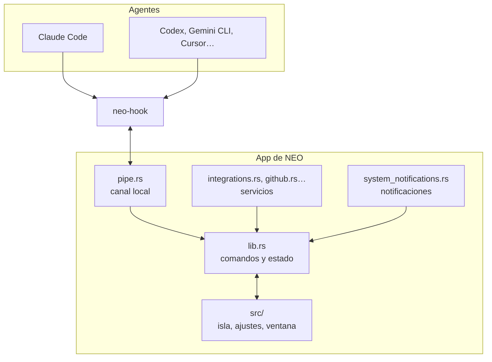
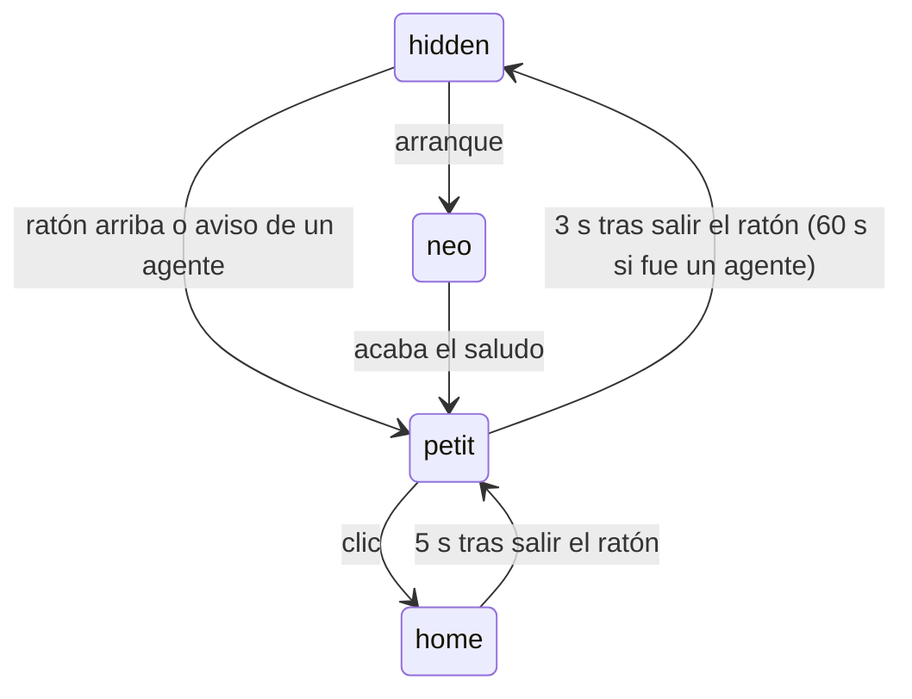

# Arquitectura de NEO

NEO son tres piezas que se comunican por canales locales: el programa `neo-hook`, el núcleo en Rust y la interfaz en TypeScript.

## Las piezas

### `neo-hook` (`app/hook/`)
Un ejecutable muy pequeño y rápido, porque los agentes lo lanzan en **cada** evento. Hace tres cosas:

1. Lee el evento que el agente manda por la entrada estándar y normaliza sus campos (cada agente llama distinto a lo mismo).
2. Se lo pasa a NEO por un canal local: un *named pipe* en Windows (`\\.\pipe\neo-<SID>`) o un socket Unix en Linux. Ambos extremos comprueban que el otro corre con el mismo usuario.
3. Si el evento es una petición de permiso, espera la decisión y se la devuelve al agente en el formato que este espera.

**Regla de oro:** nunca bloquea al agente. Si NEO no responde, sale enseguida sin decidir nada, y el agente pregunta en su terminal como si NEO no existiera. Nunca aprueba nada por su cuenta.

### El núcleo (`app/src-tauri/`)
La parte en Rust, sobre [Tauri 2](https://tauri.app). Crea las ventanas y es lo único que toca el sistema:

| Módulo | Qué hace |
|---|---|
| `pipe.rs`, `hooks.rs`, `agents.rs` | Canal con `neo-hook` e instalación de hooks en cada agente |
| `island.rs` | Geometría de la isla y paso de clics a lo que hay debajo |
| `system_notifications.rs` | Notificaciones de Windows en la isla |
| `integrations.rs`, `github.rs`, `spotify.rs`, `whatsapp/` | Servicios externos |
| `chat.rs`, `claude.rs`, `openai_compat.rs`, `local_chat.rs` | Chat con cada proveedor |
| `flow/`, `speech/`, `notes/`, `voice/` | Dictado, voz, Notetaker y « OK NEO » |
| `update.rs` | Actualizaciones desde las releases de GitHub |
| `secrets.rs` | Claves en el llavero del sistema |
| `platform/` | Todo lo que cambia entre Windows y Linux |

### La interfaz (`app/src/`)
TypeScript y CSS sin framework, para que la isla arranque al instante.

| Carpeta | Qué hay |
|---|---|
| `island/` | La isla: máquina de estados, hooks, avisos |
| `views/` | Cada tarjeta de la isla |
| `neo/` | El personaje: motor (`engine.ts`), aspecto (`neo-look.ts`), trajes y saludo |
| `hub/` | Ventana principal |
| `settings/` | Secciones de ajustes |
| `core/` | Estado compartido y puente con Rust (`bridge.ts`) |
| `i18n/` | Textos en 12 idiomas, indexados por su texto en inglés |

## Cómo se abre y se cierra la isla

La máquina de estados de `island/fsm.ts` tiene cuatro estados:

- `hidden`: una franja invisible arriba. La ventana se encoge y el seguimiento del cursor se para, para no gastar CPU.
- `petit`: barra compacta.
- `home`: isla abierta.
- `neo`: saludo al arrancar.

Una petición de permiso *fija* la isla abierta hasta que respondes.

## Notificaciones de Windows

NEO lee los avisos de `%LOCALAPPDATA%\Microsoft\Windows\Notifications\wpndatabase.db`, la base SQLite donde Windows los guarda, en modo solo lectura:

1. Cada 2 s comprueba la fecha y el tamaño del archivo, solo con el interruptor encendido.
2. Si cambió, lee los avisos con un `Id` mayor que el último visto.
3. Saca el título y el texto del XML y se los manda a la isla.

Para que el aviso no salga dos veces, apaga el valor `ShowBanner` de esa app en el registro. Guarda qué apps tocó en `hidden-banners.json` y se lo devuelve al apagar la función o silenciar la app.

**Limitación conocida:** el formato de esa base y `ShowBanner` no están documentados por Microsoft. Si una actualización de Windows los cambia, NEO deja de avisar y lo apunta en su log. La alternativa oficial (`UserNotificationListener`) exige empaquetar la app como MSIX firmado.

## Distribución

Al subir una etiqueta `windows-v*`, `.github/workflows/windows.yml`:

1. Comprueba que la etiqueta coincide con la versión de `tauri.conf.json`, `package.json` y `Cargo.toml`.
2. Compila y genera los instaladores.
3. Publica la release y actualiza la release fija `windows-latest`.

`update.rs` consulta esas releases, solo si le diste permiso, y descarga el instalador comprobando su hash.

## Reglas del proyecto

- Nunca bloquear a un agente: si la app no responde, el hook sale enseguida.
- Nunca sobrescribir la configuración de un agente: copia con fecha, mezclar, enseñar el diff y escribir solo con tu confirmación.
- Nunca aprobar un permiso ni enviar un email sin un clic explícito.
- Los secretos van al llavero del sistema, nunca a disco ni a git.
- 0 % de CPU con la isla escondida.
